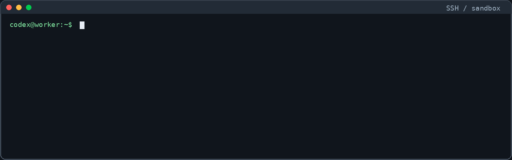

# codex-starter-kit
<!-- codex-starter-kit version: 2.0.0 -->

A starting point for working with ChatGPT and Codex CLI on projects inside an
isolated Linux VM. ChatGPT orchestrates work via Remote Desktop Commander;
Codex handles substantial coding tasks, and you review the results.

## Example




## Architecture


## Recommendations

Use a disposable VM, a nonprivileged account and firewall rules outside the
VM that isolate your LAN and host while allowing the access you explicitly need.
Keep credentials and personal files out of the sandbox. Review changes before
committing, publishing or deploying. See [security](specs/security.md).

## Bootstrap the sandbox

Install Bash, Git, Python 3, Node.js/npm/npx, tmux, Codex CLI and your project's
dependencies in the VM. Sign in to Codex with the VM account, then:

```bash
git clone https://github.com/SuperMiaw/codex-starter-kit ~/codex-starter-kit
~/codex-starter-kit/bootstrap/check-requirements.sh all
~/codex-starter-kit/bootstrap/setup.sh --preview
~/codex-starter-kit/bootstrap/setup.sh --install-hook
~/codex-starter-kit/bootstrap/setup.sh --install-service
```

The hook prints a reminder in eligible human Bash SSH sessions; the service
installation does **not** start the bridge. Start it yourself when ready:

```bash
systemctl --user start desktop-commander.service
```

To view connection details, use `tmux attach -t desktop-commander`. Restarting
an existing bridge disconnects its current session. Full setup behavior:
[bootstrap specification](specs/bootstrap.md).

## Connect ChatGPT and receive SSH notifications

Connect the Remote Desktop Commander plugin in ChatGPT using the bridge's
connection information. In the VM, display the prompt to copy:

```bash
~/codex-starter-kit/bootstrap/remote-control.sh --show
```

Paste its instruction into ChatGPT. It reads `bootstrap/PROMPT.md`,
acknowledges, then waits. Ask it to work on a project using its **absolute VM
path**, desired changes and acceptance checks. It can edit small tasks directly
or hand off substantial work to Codex. The runner automatically sends START,
END and ERROR notifications to your SSH terminals with a shared active-task
count. Notifications are best effort; verify actual task results.

For direct use of the runner and task status, see
[notifications](specs/notifications.md). Optional project-specific instructions
are available in [templates](templates/). You can also use
[codex-sync](https://github.com/SuperMiaw/codex-sync) to sync projects.

## Technical specifications

[Architecture](specs/architecture.md) ·
[Bootstrap](specs/bootstrap.md) ·
[Handoff](specs/handoff.md) ·
[Notifications](specs/notifications.md) ·
[Security](specs/security.md) ·
[Releases](specs/releases.md)

Release tags use plain `a.b.c` versions (no `v`). Run
`./release.sh --check` before releasing.
