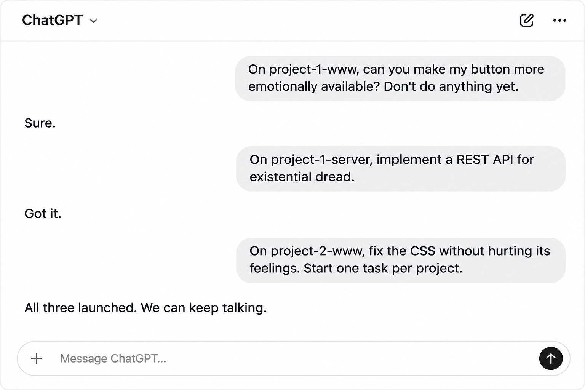
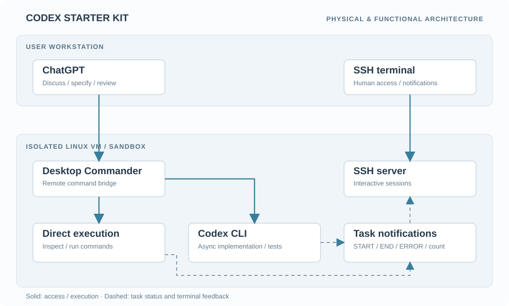

# codex-starter-kit

A lightweight workflow for agentic coding in an isolated Linux VM.

Discuss your project with ChatGPT, then let it orchestrate Codex through
[Remote Desktop Commander](https://github.com/wonderwhy-er/DesktopCommanderMCP).

## Workflow

## Architecture

## Getting started

1. [Prepare your environment](docs/requirements.md).
2. Choose a startup mode:
   - [One-shot](docs/one-shot-startup.md): temporary foreground session.
   - [Persistent](docs/persistent-setup.md): SSH reminder and systemd user service.

For additional configuration and optional features, see
[advanced usage](docs/advanced-usage.md).

Human setup commands live directly in [bootstrap/](bootstrap/). Give ChatGPT
[bootstrap/PROMPT.md](bootstrap/PROMPT.md) for the remote workflow. Its commands
and optional prompt extensions live in [bootstrap/orchestration/](bootstrap/orchestration/),
with their implementation in `bootstrap/internal/`. Repository maintainers use
the root [release.sh](release.sh) command.
