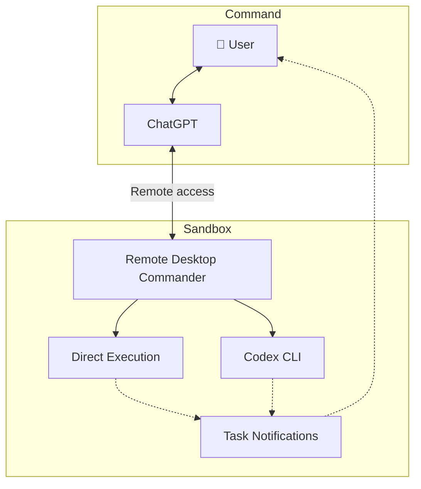

# codex-starter-kit

A starting point for working on projects with ChatGPT and Codex CLI in
an isolated Linux VM. ChatGPT connects through Remote Desktop Commander; Codex
edits and checks your project, and you review the results. Adapt the instructions
and templates to your needs.

## Architecture Overview



## Getting started

1. **Prepare the VM.** Follow [Security](#security) before connecting. Use a
   nonprivileged account without administrative access. Install Bash, Git,
   Python 3, Node.js with npm/npx, Codex CLI, and your project's tools. Complete
   Codex sign-in as that account.

2. **Clone this kit on the VM.** In that account's terminal, replace the placeholder
   with this repository's clone URL:

   ```bash
   git clone https://github.com/SuperMiaw/codex-starter-kit ~/codex-starter-kit
   ```

3. **Start the bridge yourself.** Run this in the VM terminal before ChatGPT can
   access it remotely, and keep it running:

   ```bash
   ~/codex-starter-kit/bootstrap/remote-control.sh
   ```

   The first run may download the bridge. It prints connection information and a
   short instruction to paste into ChatGPT.

4. **Connect ChatGPT.** In the ChatGPT web app, configure the **Remote Desktop
   Commander plugin** using the bridge's connection information and the plugin's
   instructions. Your account must have access to the plugin; this kit does not
   install or configure it.

5. **Paste the banner's instruction into the conversation.** It tells ChatGPT to
   read [bootstrap/PROMPT.md](bootstrap/PROMPT.md) at its actual absolute VM path.
   Nothing is sent automatically. ChatGPT acknowledges the instructions and waits
   without starting tasks or changing the environment. Explicitly request a
   read-only connectivity/prerequisite check if wanted.

6. **Give ChatGPT a task.** Supply your existing project's absolute VM path, the
   desired change, and acceptance checks. Optionally adapt a [project template](#project-templates)
   as the project's root `AGENTS.md`, reconciling existing instructions before
   replacing them. ChatGPT reads those instructions, delegates work to Codex, and
   reviews the result. Keep the existing project directory; do not initialize Git
   for this setup. Check task output and exit status; START/END notifications are
   best effort.

For runner commands and notification examples, see
[bootstrap/PROMPT.md](bootstrap/PROMPT.md). Confirm absolute bundle and project
paths on the VM before running tasks; ChatGPT's local sandbox paths are separate.

## Security

- **Before connecting, configure a firewall outside the VM.** Block access to the
  LAN, host, and management services while allowing necessary Internet access and
  any trusted administration access. Keep a VM console available. The human
  manages firewall policy; agents must not weaken it.
- Use a disposable, isolated VM and keep backups. Keep production credentials,
  personal files, and host mounts out of it. NAT and Codex's workspace sandbox do
  not replace VM/network isolation.
- Keep connection tokens private. Remote commands can affect anything the VM
  account can access.
- When syncing files, exclude secrets and local configuration and use only trusted
  administration access allowed by the firewall. Keep Git operations and final
  review/integration on your trusted local machine.
- Review changes before committing, publishing, or deploying.

## Project templates

- [FastAPI backend](templates/fastapi-backend/AGENTS.md)
- [Alpine frontend](templates/alpine-frontend/AGENTS.md)
- [Python CLI](templates/python-cli/AGENTS.md)
- [Debian script](templates/script-debian/AGENTS.md)
- [FreeBSD script](templates/script-freebsd/AGENTS.md)
- [Legacy project](templates/legacy/AGENTS.md)

## Going Further

Optionally use [codex-sync](https://github.com/SuperMiaw/codex-sync) to sync projects
between your local machine and sandbox.
