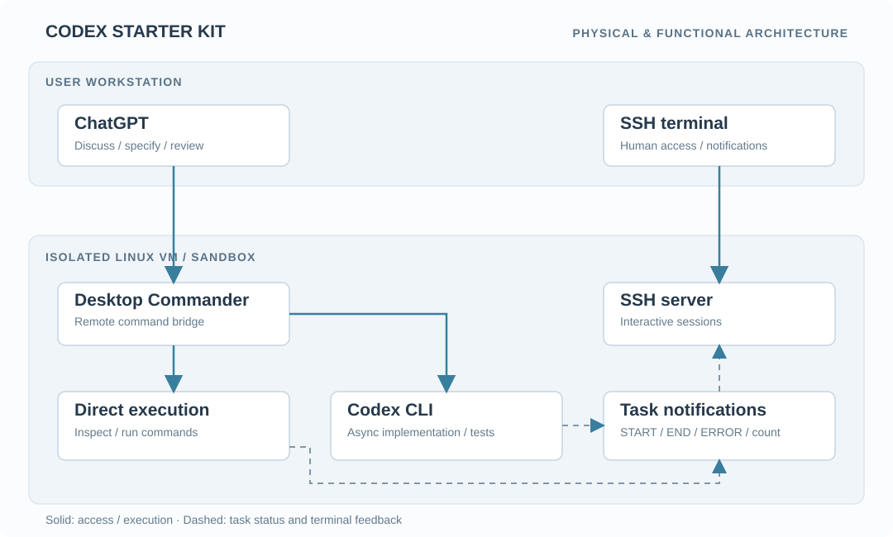

# Architecture

The human operates ChatGPT and a terminal connected to an isolated,
unprivileged Linux worker VM.
Remote Desktop Commander gives ChatGPT access to that VM. ChatGPT may make
small authorized edits directly or delegate implementation to Codex CLI through
the wrapper. The human reviews task results and integrates changes.

The VM and ChatGPT local sandbox are separate filesystems. The bridge connection
does not replace external firewall isolation. The terminal notifications are
best-effort signals, not proof that a task succeeded.

The optional [Playground skill](../bootstrap/skills/PLAYGROUND.md) describes
a separate, human-prepared, dedicated SSH-accessible VM for authorized Codex
work with sudo or Docker. Its task and cleanup authorization and target and
isolation verification are independent of worker access. The kit supplies
conversation guidance only. Provisioning and access configuration remain with
the human.

Human entrypoints live at the bootstrap root. `bootstrap/SYSTEM_PROMPT.md`
guides ChatGPT in the conversation and points to optional instructions in
`bootstrap/skills/`. These paths are starter-kit conventions for ChatGPT,
independent of native Codex skill discovery and API message roles. Executable
orchestration commands live in `bootstrap/orchestration/`.
Shell entrypoints delegate to Python and shared shell code in
`bootstrap/internal/`. The service unit invokes `bootstrap/internal/desktop-commander.sh`
and the SSH hook invokes `bootstrap/remote-control.sh`.

See [Security](security.md), [Bootstrap](bootstrap.md), and
[Notifications](notifications.md) for operational contracts. The
[BATCH contract](batch-execution.md) covers DAG scheduling and shared resource
coordination with the direct runner.
